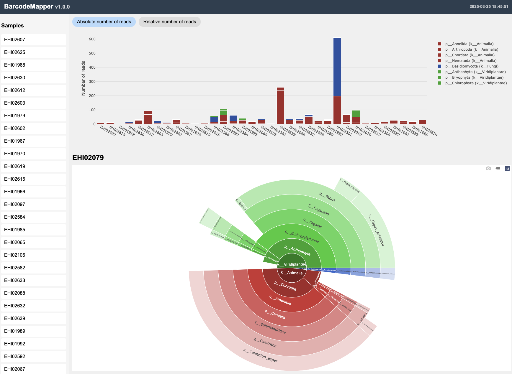

# Outputs

For `-o results/taxonomy.tsv`, BarcodeMapper writes:

| File | Contents |
| --- | --- |
| `results/taxonomy.tsv` | Taxonomy paths and one count column per sample, including zero-hit samples. |
| `results/taxonomy.html` | Offline, self-contained bar and sunburst plots. |
| `results/taxonomy.manifest.json` | Version, parameters, tool versions, database checksum, inputs, and fastp/assignment counts. |

The working directory additionally holds fastp reports and, unless `--no-bam` is used, one BAM per sample in `bowtie/`.

## Reading the count table

Counts are propagated to every resolved ancestor. A fragment assigned to species therefore also appears in its genus, family, and higher-rank rows. **Do not sum all taxonomy rows** to obtain a total.

- A fragment with no shared named taxon is `Unclassified`.
- A sample with no accepted alignments has a zero column.
- Both mates of a pair share a read ID and receive one lowest-common-ancestor assignment.

## HTML report

The report's relative bars use assigned fragments at the phylum level plus unresolved and unclassified fragments as the denominator, and are labelled as a fraction of marker-matching fragments.

## Manifest

The JSON manifest records everything needed to reproduce a run: BarcodeMapper version, parameters, tool versions, the database checksum, the input files, and fastp and assignment counts. Keep it with the count table.
